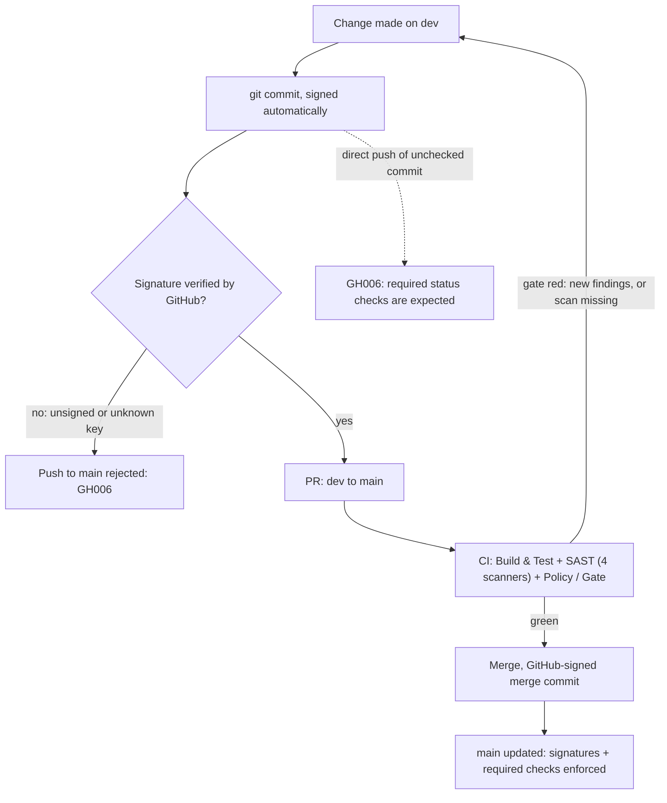

# caller-repo

A small Node.js application that is the reference consumer of this org's reusable build
workflow: [enofei/reusable-build-test](https://github.com/enofei/reusable-build-test).

## Why this repository exists

This repository has two purposes: prove that adopting the shared pipeline is a one-job
change (everything CI-related lives in `.github/workflows/ci.yml`, and the rest of the
repository is ordinary application code), and act as the testbed for this org's branch and
signing policy, which both repositories enforce identically.

## How CI works

```yaml
jobs:
  build-and-test:
    name: Build & Test
    uses: enofei/reusable-build-test/.github/workflows/build-test.yml@fee2b6b36444d90fe66821b6c362eb400dfe29e8  # v1.0.0
    with:
      node-version: '24'
      test-command: 'npm run test:ci'
      security-checks: true

  sast:
    name: SAST
    permissions:
      contents: read
      security-events: write
    uses: enofei/reusable-build-test/.github/workflows/sast.yml@fee2b6b36444d90fe66821b6c362eb400dfe29e8  # v1.0.0
    with:
      semgrep-config: 'policy/semgrep-rules'

  policy:
    name: Policy
    if: ${{ always() }}
    needs: [sast]
    permissions:
      contents: read
      actions: read
    uses: enofei/reusable-build-test/.github/workflows/policy.yml@fee2b6b36444d90fe66821b6c362eb400dfe29e8  # v1.0.0
    with:
      mode: ${{ github.base_ref == 'dev' && 'warn' || 'enforce-full' }}
      policy-path: 'policy/'
```

On every pull request, three jobs run:

1. **Build & Test**: install from the lockfile, build, test, audit deps.
2. **SAST**: four scanners, all static (no build), each uploading SARIF to code
   scanning and archiving an artifact for the gate; plus **Actionlint**
   over the caller's own workflows (pinned binary, shellcheck + pyflakes
   on embedded scripts - job-level, no SARIF path):
   - **Semgrep** - rule bundle frozen in `policy/semgrep-rules/` (nothing fetched
     from the network at scan time)
   - **Gitleaks** - secrets, both the worktree and the full git history;
     documented false positives suppressed via `.gitleaksignore`
   - **Trivy fs** - dependency CVEs from lockfiles and IaC/Dockerfile
     misconfigurations (misconfig checks frozen in the digest-pinned binary;
     vulnerability DB downloaded with Trivy's signature verification)
   - **Dependency Review** - fails on PRs that introduce vulnerable
     dependencies (own required check; no SARIF path)
3. **Policy / Gate**: a fail-closed OPA gate that downloads **all** SARIF
   artifacts (any missing => red), merges them, verifies conftest against an
   embedded SHA-256, runs the policy unit tests, then evaluates
   `policy/sast.rego` against the findings baseline `policy/baseline.json`:

| Mode | Behavior |
|---|---|
| `warn` | advisory only: findings annotate the run, never block |
| `enforce-critical` | blocks on findings at error level |
| `enforce-full` | blocks on every finding, any level |

Repository policy: **`dev` runs `warn` only** (never any enforce mode), **`main`
runs `enforce-full` only**. `enforce-critical` is supported by the reusable
gate but unused in this repository.

There are **no path exemptions**: dvwa findings are scanned and evaluated like
everything else. Known findings are fingerprinted in `policy/baseline.json`
(sha256 of tool+rule+path+message), but that ratchet only governs refs **off
`main`**. On `main` the reusable workflow **bypasses the baseline entirely**
(empty fingerprints) *and* clamps the mode to `enforce-full`, so no risk is
ever accepted there: any finding at all - old (baseline) or new - turns
`Policy / Gate` red, for PRs targeting `main` (merge blocked) and for every
push landing on `main`.

Because of that, the repository is in a deliberate **zero-tolerance freeze**:
with dvwa's 51 known findings present, every `main`-bound gate is red by
design, and **nothing merges to `main` while it is red** - never merge a red
pipeline. The freeze lifts only when the findings are resolved (fixed or the
accepted-risk content removed from the tree). Malformed or missing scan
results or baseline fail the gate (red, never green). Required status checks
on `main`: `Policy / Gate`, `SAST / Semgrep`, `SAST / Gitleaks`,
`SAST / Trivy`, `SAST / Dependency Review`, and `SAST / Actionlint`.

PR gate modes split by base branch: PRs targeting `dev` run **`warn`**
(advisory - `dev` passes regardless of findings; they annotate the run only),
while PRs targeting `main` run **`enforce-full`** (plus the baseline bypass
above). Gate-test runs **`warn` only** - manual dispatch and the push smoke on
`dev` alike - with distinct check names (`SAST Test / *`, `Gate Test / Gate`)
that can never satisfy `main`'s required checks.

`ci.yml` also triggers on `push` to `main`: every commit that lands gets its
own run with the baseline bypassed and mode clamped to `enforce-full`, with
`Policy / Gate` reported directly on `main`'s HEAD. While accepted-risk content
lives in the tree this run is **red by design** - the permanent, alertable
record that `main` holds vulnerabilities, and the immediate red flag for
anything landing through break-glass. GitHub checks run asynchronously, so
findings never reject the push itself; pre-push prevention is the blanket
`GH006` rule above (any unchecked push is refused).

## Security model

Protection works at two layers: the application and the repository itself.

### What protects the application (shift-left)

| Threat | Control |
|---|---|
| Vulnerable code (injection, unsafe `eval`, ...) committed | Semgrep + Gitleaks + Trivy scan every PR; `Policy / Gate` blocks any finding not in the baseline before merge; `main`-bound PRs and `main` runs ignore the baseline - any finding fails the gate (zero-tolerance freeze) |
| Hardcoded secrets committed | Gitleaks scans worktree + history every PR; Push Protection as a second layer |
| Known-vulnerable dependencies | `npm audit` fails the build; Trivy reads lockfiles without building; Dependency Review blocks PRs that introduce vulnerable deps; Dependabot opens update PRs (7-day cooldown) |
| IaC / Dockerfile / workflow misconfigurations | Trivy misconfig scanner (checks frozen in the digest-pinned binary) |
| Findings in intentional test content | no exemptions: known dvwa findings live in `policy/baseline.json` (reviewed, fingerprinted) and gate merges off `main`; on `main` every finding - baseline or new - fails the gate (freeze) |

### What protects the repository (zero-trust CI)

| Threat | Control |
|---|---|
| Tampered actions or scanner images | every `uses:` SHA-pinned with `# vX.Y.Z`; Semgrep, Gitleaks, and Trivy run from digest-pinned containers; actionlint binary sha256-verified before exec |
| Workflow injection / broken expressions | Actionlint lints `.github/workflows/` on every run (expression checks + shellcheck/pyflakes on `run:` blocks) |
| Poisoned rule source at scan time | Semgrep rules vendored in `policy/semgrep-rules/` (hash in `SOURCE.txt`); Trivy misconfig checks frozen in the pinned binary; `.gitleaksignore` reviewed like code |
| Tampered policy toolchain | conftest verified against an embedded SHA-256 before execution |
| Committed secrets | Push Protection blocks known provider formats at push; Secret Scanning alerts on anything that lands; Gitleaks double-covers worktree + history on every PR |
| Direct push of unchecked code to `main` | required status checks + signatures; rejected with `GH006` (verified by test) |
| Vulnerable content landing while checks are stripped (break-glass) | push trigger rescans every landing commit under `enforce-full`; red `Policy / Gate` on `main`'s HEAD flags it for immediate revert (post-landing tripwire) |
| Single-key self-merge of gate changes | `.github/CODEOWNERS` documents ownership; a hard 1-code-owner-approval gate is configured-but-off (GitHub cannot self-approve, so it needs a second identity - enable snippet below) |
| Commit forgery | SSH-signed commits required, administrators included |
| History rewrite | force-push and branch deletion disabled on `main` |
| Gate failing open (missing results, missing baseline, invalid mode) | fail-closed: any anomaly = red, never green |
| Loosening the gate on merges | `main` is hard-clamped to `enforce-full` *and* bypasses the baseline in the reusable workflow; baseline additions are reviewed in signed PRs (they affect off-`main` gating only) |

### If a secret is ever committed (rotation runbook)

1. **Rotate first** - provider console/API, before touching git. Assume the
   token is burned the moment it exists in any commit.
2. Push Protection normally rejects known formats at push; if it didn't
   (novel format, private key), Secret Scanning will alert - open the alert
   and follow its provider-specific remediation link.
3. Remove from history: `git filter-repo --replace-text` on `dev`, force-push
   **`dev` only** (main forbids force-pushes by design; if it reached `main`,
   rotate + open an incident note - history rewrite of `main` is not an option).
4. Verify: Secret Scanning alerts page empty; `SAST / Gitleaks` green on the
   next PR; add the fingerprint to `.gitleaksignore` only if it is a
   documented placeholder, never a real credential.

### Defense in depth

`signature check -> SAST scan -> policy gate -> GitHub enforcement`. Four
independent layers: compromising one leaves the others standing. The
pipeline follows established supply-chain practice with immutable pins,
fail-secure defaults, and tooling verified before it runs.

## Branch and signing policy

- `dev` is where work happens. Push to it freely; every push (and manual
  `workflow_dispatch`) runs the `Gate Test` **warn-only** smoke.
- `main` accepts only commits with verified signatures. Branch protection applies to
  administrators too, so unsigned or unverified pushes are rejected by GitHub with `GH006`.
- Six status checks are required on `main`: `Policy / Gate`, `SAST / Semgrep`,
  `SAST / Gitleaks`, `SAST / Trivy`, `SAST / Dependency Review`, and
  `SAST / Actionlint` (strict, so the branch must be up to date). A direct push of a commit that has
  not passed them is rejected with `GH006`; the admin bypass flag is refused as
  well. In practice, changes land through a pull request. Break-glass (gate
  outage): see the runbook below.
- Signing is automatic on a configured machine: `commit.gpgsign=true` with an SSH signing
  key registered on the GitHub account. `git verify-commit HEAD` checks a commit locally.
- Pull requests can be merged to `main`; GitHub signs its own merge commits, so they pass
  the signature gate, but still have to pass the policy gate.



### Break-glass runbook (required status checks on main)

With `enforce_admins: true` + required checks, a red gate blocks all merges;
the UI cannot bypass (`--admin` is refused too). That is the policy: never
merge a red pipeline - the sequence below is **only** for a gate *outage*
(false positives, broken infrastructure), never to land content the gate
rejected. It doubles as outage recovery:

```bash
# 1. remove ONLY the status-check requirement (signatures stay intact)
gh api -X DELETE repos/enofei/caller-repo/branches/main/protection/required_status_checks

# 2. fix the problem; merges reopen (signature requirement remains)

# 3. re-enable: PUT needs a PUT-shaped body (a raw GET snapshot 422s:
#    booleans, not {enabled:} objects; required_pull_request_reviews and
#    restrictions required, as null; clean required_status_checks)
cat > /tmp/body.json <<'JSON'
{
  "required_status_checks": {"strict": true, "contexts": [
    "Policy / Gate", "SAST / Semgrep", "SAST / Gitleaks",
    "SAST / Trivy", "SAST / Dependency Review", "SAST / Actionlint"]},
  "enforce_admins": true,
  "required_pull_request_reviews": null,
  "restrictions": null,
  "allow_deletions": false,
  "allow_force_pushes": false,
  "allow_fork_syncing": false,
  "block_creations": false,
  "lock_branch": false,
  "required_conversation_resolution": false,
  "required_linear_history": false
}
JSON
gh api -X PUT repos/enofei/caller-repo/branches/main/protection --input /tmp/body.json
# verify-diff: GET must match pre-DELETE state on every key
gh api repos/enofei/caller-repo/branches/main/protection \
  --jq '{admins: .enforce_admins.enabled, sigs: .required_signatures.enabled, checks: .required_status_checks.contexts, force: .allow_force_pushes.enabled}'
```

Never touch `required_signatures` to solve a gate problem: only
`required_status_checks` is ever added or removed.

Stripping the requirement removes prevention, not the scan: `ci.yml` still
triggers on pushes to `main`, and the baseline bypass still applies - while
accepted-risk content exists, a red `Policy / Gate` on `main`'s HEAD is the
expected state, not an alert. Investigate only if a finding is *new* relative
to the baseline (i.e. first-party or a newly introduced dvwa path).

### Required-review gate (advisory until a second identity exists)

A hard code-owner review gate was proven live (PR #22 blocked as
`REVIEW_REQUIRED`) but GitHub refuses author self-approval, so with one
account it would block every merge. `.github/CODEOWNERS` stays as the
ownership map; flip this on the day a second reviewer identity exists.
Full `PUT /protection` as in the runbook above, with this key added:

```json
"required_pull_request_reviews": {
  "dismiss_stale_reviews": true,
  "require_code_owner_reviews": true,
  "required_approving_review_count": 1,
  "require_last_push_approval": false
}
```

`require_last_push_approval: false` keeps the last-pusher rule out of it;
the author still cannot approve their own PR - the second identity is the
point.

## Application layout

| Path | Purpose |
|---|---|
| `src/index.js` | Application code (`slugify`, `greet`) |
| `scripts/build.js` | Bundles `src/` into `dist/` and writes build metadata |
| `test/index.test.js` | Tests on Node's built-in `node:test` runner |
| `policy/sast.rego` | Gate policy: modes, baseline matching, deny/warn rules |
| `policy/sast_test.rego` | Policy unit tests (`conftest verify` runs them in CI) |
| `policy/baseline.json` | Fingerprints of known findings (vendored dvwa corpus) |
| `policy/semgrep-rules/` | Frozen Semgrep rule bundle (provenance: `SOURCE.txt`) |
| `.gitleaksignore` | Documented Gitleaks false positives (vendored rule patterns) |
| `.github/workflows/ci.yml` | PR pipeline: build + SAST + gate |
| `.github/workflows/gate-test.yml` | Dev-branch mode testing (distinct check names) |
| `scripts/update-baseline.sh` | Regenerates `policy/baseline.json` from local scans |
| `scripts/sarif_to_baseline.py` | SARIF -> baseline fingerprint generator |

No third-party runtime dependencies. Requires Node.js 24 (current LTS); `engines` is set to
`>=24`.

## Vendored third-party code

| Path | Upstream | License | Purpose |
|---|---|---|---|
| `dvwa/` | [digininja/DVWA](https://github.com/digininja/DVWA) (`43b0f8b`) | GPL-3.0 (`dvwa/COPYING.txt`) | Intentionally vulnerable PHP app used as SAST test content |

`dvwa/` is an unmodified copy of DVWA's source with `.git/` and `.github/` removed; no
upstream workflows or automation run in this repository. It is **not deployed, installed,
or executed here**; CI only analyzes it statically. The rest of this repository remains
MIT-licensed; DVWA's files stay under GPL-3.0 as shipped.

## Local development

```bash
npm ci
npm run build
npm run test:ci
npm audit --audit-level=high
```

These are the same commands CI runs. The policy and scanners can be exercised
locally too:

```bash
conftest verify --policy policy/           # policy unit tests (17)
scripts/update-baseline.sh                 # regenerate baseline.json (needs docker)
```

Baseline updates (tool pin bumps, dvwa re-vendors) are reviewed like code:
every added fingerprint is a finding that stops blocking once merged. The
baseline only accepts `dvwa/` paths - first-party findings are fixed or
allowlisted at the tool level (`.gitleaksignore`), never baselined.

## Updating the workflow pin

The `uses:` reference is SHA-pinned to a release tag of `reusable-build-test` with a
`# vX.Y.Z` comment. To resolve a new tag:

```bash
git clone https://github.com/enofei/reusable-build-test.git
./reusable-build-test/scripts/resolve-action-sha.sh enofei/reusable-build-test v1.0.0
# prints: <commit-sha>  # v1.0.0
```

Dependabot also opens weekly PRs proposing pin updates. Note that the reusable repository
publishes a single rolling release tag, so pins only move when that tag is re-cut.
